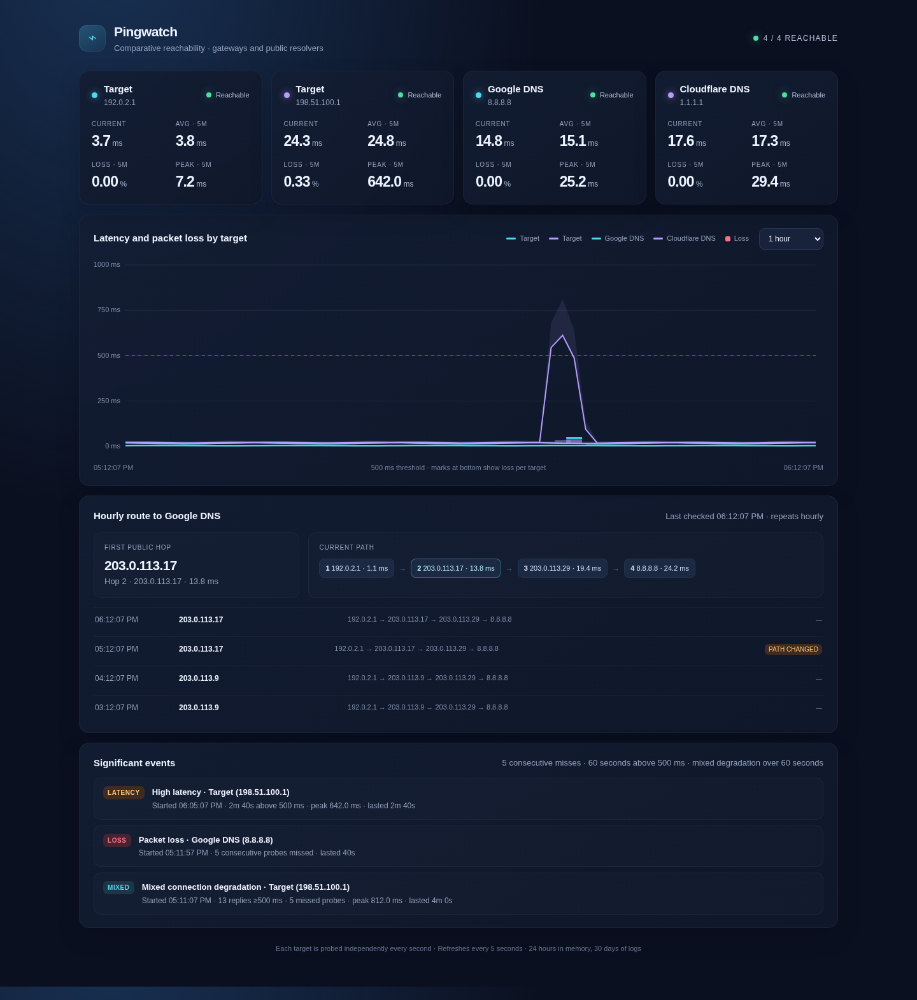

# Pingwatch

Pingwatch is a small Rust network monitor with a live web dashboard. It probes configured IPv4 or IPv6 targets, writes JSON Lines logs, keeps recent samples in memory, and records hourly route traces to `8.8.8.8`.



## Features

- Independent reachability probes, once per second by default.
- A configurable timeout of up to 10 seconds, so a slow reply can be recorded as latency instead of an immediate loss.
- Per-target latency and loss summaries, chart history, and incidents for repeated loss, sustained latency above 500 ms, and mixed degradation.
- An hourly `tracepath`/`traceroute` snapshot that identifies the first public hop when available.
- A read-only JSON API and health endpoint.
- Daily JSONL logs with 30-day file retention; the latest 24 hours of samples are loaded into memory.

## Build and run

The monitor expects `ping` and either `tracepath` or `traceroute` to be installed on the host.

```sh
cargo build --release
./target/release/pingwatch
```

The generic defaults probe Google Public DNS (`8.8.8.8`) and Cloudflare DNS (`1.1.1.1`). Override them with a comma-separated `PING_HOSTS` environment variable. The older single-target `PING_HOST` variable is still supported when `PING_HOSTS` is unset.

Other settings:

| Variable | Default | Purpose |
| --- | --- | --- |
| `PING_INTERVAL_SECS` | `1` | Seconds between probes to each target |
| `PING_TIMEOUT_SECS` | `10` | Maximum wait for one probe, clamped to 1–10 seconds |
| `LISTEN_ADDR` | `0.0.0.0:8787` | Dashboard/API listen address |
| `DATA_DIR` | `/var/lib/pingwatch` | Log and route history directory |

The dashboard listens on port `8787` by default. Configure targets and runtime paths with the environment variables above or with a service manager.

## Service

A generic systemd unit and environment example are provided in `conf/`. Review the unit's user, executable, and data paths for the host before installing it.

## HTTP endpoints

- `/` — dashboard
- `/healthz` — plain-text health response
- `/api/state?seconds=3600` — current targets, summaries, incidents, chart series, and route history. The window is clamped to 60 seconds through 24 hours.

The API is read-only and unauthenticated. Keep the listener on a trusted network; do not expose it directly to the public internet.

Ping samples are written as `samples-YYYY-MM-DD-<target>.jsonl`; route snapshots use `tracepath-YYYY-MM-DD.jsonl`. Logs contain the configured target addresses, timestamps, and measured results, so keep real log files outside the source repository.
